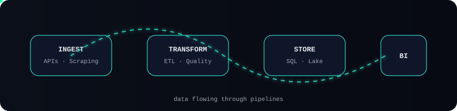

\<!-- HERO -->

\<h1 align="center">⚡ AI Engineer · Data Engineering · Agentic AI ⚡\</h1>

\

&#x20; \
\

\

&#x20; \<b>AI Engineer @ Amadeus 🇫🇷\</b>\ 
&#x20; MSc Data Engineering for AI @ DSTI
\

\

&#x20; \<a href="[https://www.linkedin.com/in/pradeepjoel/](https://www.linkedin.com/in/pradeepjoel/)">
&#x20;   \
&#x20; \</a>
&#x20; \<a href="[https://www.pradeepjoel.com](https://www.pradeepjoel.com)">
&#x20;   \
&#x20; \</a>
&#x20; \<a href="mailto\:pradeepjoelx\@gmail.com">
&#x20;   \
&#x20; \</a>
\

\ 

\<!-- MAIN CONTENT -->

\<table align="center" width="92%">
\<tr>
\<td align="center">

\<h3>👨‍💻 About Me\</h3>

\

I'm an \<b>AI Engineer at Amadeus\</b>, pursuing an \<b>MSc in Data Engineering for AI at DSTI, France\</b>.
\

\

My work and interests span \<b>Python development, AI agents, data engineering, and intelligent automation\</b>. I'm focused on building reliable engineering foundations and exploring how AI connects with data-intensive applications.
\

\

\<b>Current focus:\</b> Python · Agentic AI · PySpark · APIs · Data Engineering
\

\ 

\<h3>🧰 Tech Stack\</h3>

\<table width="100%">
&#x20; \<tr>
&#x20;   \<td width="28%" align="center">\<b>Programming & Analytics\</b>\</td>
&#x20;   \<td align="center">
&#x20;     \<code>Python\</code> · \<code>SQL\</code> · \<code>Pandas\</code> · \<code>EDA\</code> · \<code>Feature Engineering\</code>
&#x20;   \</td>
&#x20; \</tr>
&#x20; \<tr>
&#x20;   \<td align="center">\<b>Data Engineering\</b>\</td>
&#x20;   \<td align="center">
&#x20;     \<code>ETL Pipelines\</code> · \<code>Data Modeling\</code> · \<code>APIs\</code> · \<code>Web Scraping\</code>
&#x20;   \</td>
&#x20; \</tr>
&#x20; \<tr>
&#x20;   \<td align="center">\<b>Big Data & BI\</b>\</td>
&#x20;   \<td align="center">
&#x20;     \<code>Apache Spark (learning)\</code> · \<code>Power BI\</code> · \<code>Tableau\</code>
&#x20;   \</td>
&#x20; \</tr>
&#x20; \<tr>
&#x20;   \<td align="center">\<b>AI & Machine Learning\</b>\</td>
&#x20;   \<td align="center">
&#x20;     \<code>Scikit-learn\</code> · \<code>ML Pipelines\</code> · \<code>AI Agents (learning)\</code>
&#x20;   \</td>
&#x20; \</tr>
&#x20; \<tr>
&#x20;   \<td align="center">\<b>Cloud & Developer Tools\</b>\</td>
&#x20;   \<td align="center">
&#x20;     \<code>Git\</code> · \<code>GitHub\</code> · \<code>VS Code\</code> · \<code>Databricks CE\</code> · \<code>AWS S3\</code> · \<code>Docker (basics)\</code>
&#x20;   \</td>
&#x20; \</tr>
\</table>

\ 

\<h3>💼 Experience\</h3>

\

\<b>AI Engineer — Amadeus\</b>\ 
\<i>September 2026 – Present | Sophia Antipolis, France\</i>\ 
Working with Python, data engineering concepts, AI-assisted application development, and intelligent agent workflows.
\

\

\<b>Data Analyst — Comcast / Media & AdTech\</b>\ 
Validated ad-delivery schedules and investigated revenue-impacting discrepancies.\ 
Collaborated with operations and business stakeholders.
\

\

\<b>Junior Data Analyst — Event & Entertainment Analytics\</b>\ 
Built analytical reports for large-scale electronic music events.\ 
SQL analysis · Dashboards · Actionable insights
\

\ 

\<h3>🚀 Currently Exploring\</h3>

\
   🐍 Python and software engineering\    🤖 AI agent architectures and workflows\    ⚡ PySpark and distributed data processing\    🔌 APIs, integrations, and developer tools\    🛠️ Debugging, testing, and maintaining Python applications \

\ 

\<!-- BRAND BADGES -->

\
   \   \   \   \ \

\ 

\<!-- EXISTING ANIMATED PIPELINE -->

\

\</td> \</tr> \</table>

\ 
